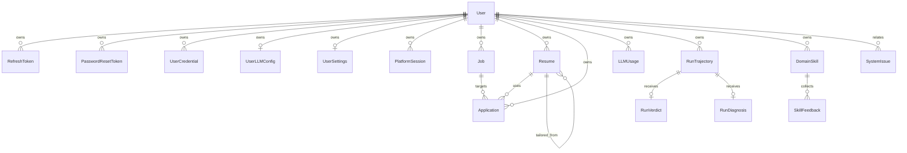

# AutoApply AI — System Architecture v2.0 (Enterprise MVP)

AutoApply AI is a full-stack, multi-tenant agentic platform that automates the job search lifecycle: aggregated multi-platform discovery, ATS compatibility scoring, automated LLM tailoring of resumes and cover letters, browser-based job submission via `browser-use` and Playwright, and a continuous self-evolving evaluation harness.

---

## Table of Contents
1. [High-Level Architecture](#1-high-level-architecture)
2. [Project Layout](#2-project-layout)
3. [Backend Architecture](#3-backend-architecture)
   - [3.1 Layered Design](#31-layered-design)
   - [3.2 Multi-Tenant Data Isolation](#32-multi-tenant-data-isolation)
   - [3.3 Security, Auth & Envelope Encryption](#33-security-auth--envelope-encryption)
   - [3.4 Asynchronous Concurrency Model](#34-asynchronous-concurrency-model)
4. [Frontend Architecture](#4-frontend-architecture)
   - [4.1 Design-Token UI & Token Architecture](#41-design-token-ui--token-architecture)
   - [4.2 State Management & Client Pipeline](#42-state-management--client-pipeline)
   - [4.3 Real-Time Event System (WebSocket)](#43-real-time-event-system-websocket)
5. [Core Engine Modules](#5-core-engine-modules)
   - [5.1 Multi-Factor ATS Scoring Engine](#51-multi-factor-ats-scoring-engine)
   - [5.2 Document Generation & Parsing Engine](#52-document-generation--parsing-engine)
   - [5.3 LLM Client Layer (AWS Bedrock & BYO Keys)](#53-llm-client-layer-aws-bedrock--byo-keys)
   - [5.4 Browser Automation & Platform Integrations](#54-browser-automation--platform-integrations)
   - [5.5 Self-Evolving Evaluation Harness](#55-self-evolving-evaluation-harness)
6. [Data Flow & Lifecycle Sequences](#6-data-flow--lifecycle-sequences)
   - [6.1 Job Discovery & Scoring Flow](#61-job-discovery--scoring-flow)
   - [6.2 Application Submission Modes (`autonomous`, `review`, `batch`)](#62-application-submission-modes-autonomous-review-batch)
   - [6.3 CAPTCHA/2FA Intervention Rendezvous](#63-captcha2fa-intervention-rendezvous)
   - [6.4 Resume Tailoring & Optimization Flow](#64-resume-tailoring--optimization-flow)
7. [API Surface & Endpoint Contracts](#7-api-surface--endpoint-contracts)
8. [Data Models & Schemas](#8-data-models--schemas)
9. [Infrastructure & Deployment](#9-infrastructure--deployment)
10. [Observability & Monitoring](#10-observability--monitoring)
11. [Enterprise MVP Roadmap & Operational Guide](#11-enterprise-mvp-roadmap--operational-guide)

---

## 1. High-Level Architecture

```
┌────────────────────────────────────────────────────────────────────────┐
│                   FRONTEND (React 18 + Vite + TypeScript)              │
│  ┌───────────────┐ ┌────────────────┐ ┌───────────────┐ ┌───────────┐  │
│  │   Dashboard   │ │  Job Discovery │ │   Resumes &   │ │Application│  │
│  │   & Pipeline  │ │  & Job Drawer  │ │ Preview Panel │ │  Tracker  │  │
│  └───────────────┘ └────────────────┘ └───────────────┘ └───────────┘  │
│  ┌──────────────────────────────────────────────────────────────────┐  │
│  │ State: Zustand (Auth, App, UI) + TanStack Query + Custom Tokens  │  │
│  └──────────────────────────────────────────────────────────────────┘  │
│       ▲                                  ▲                             │
│       │ REST (Axios + Cookies)           │ WebSocket (?ticket=...)     │
└───────┼──────────────────────────────────┼─────────────────────────────┘
        │                                  │
┌───────┼──────────────────────────────────┼─────────────────────────────┐
│       ▼                                  ▼                             │
│                    FASTAPI BACKEND (/api/v1)                           │
│  ┌──────────────────────────────────────────────────────────────────┐  │
│  │ Security Headers, CORS, Rate Limiters, Token Family Auth Guard   │  │
│  ├──────────────────────────────────────────────────────────────────┤  │
│  │ Route Handlers: /auth, /jobs, /applications, /resumes,           │  │
│  │                 /analytics, /settings, /platform-sessions, /admin│  │
│  ├──────────────────────────────────────────────────────────────────┤  │
│  │ Multi-Tenant Context Engine (do_orm_execute auto-scoped filter)  │  │
│  └────────────────────────┬─────────────────────────────────────────┘  │
│                           │                                            │
│  ┌────────────────────────▼─────────────────────────────────────────┐  │
│  │                         Service Layer                            │  │
│  │  JobSearchService · ApplicationService · ResumeService           │  │
│  │  AnalyticsService · DispatchService · PlatformSessionService    │  │
│  │  PasswordResetService · Mailer (Log/SMTP) · AccountService (GDPR)│  │
│  └────────────┬───────────┬─────────────┬───────────────────────────┘  │
│               │           │             │                              │
│  ┌────────────▼──┐ ┌──────▼──────┐ ┌────▼────────────────────────┐     │
│  │ Core Modules  │ │  LLM Layer  │ │  Queue & Workers (Arq)      │     │
│  │ ┌───────────┐ │ │ ┌─────────┐ │ │ ┌─────────────────────────┐ │     │
│  │ │ATS Scorer │ │ │ │LiteLLM  │ │ │ │ Arq Redis Pool          │ │     │
│  │ │(NLP/TFIDF)│ │ │ │Unified  │ │ │ │ ┌─────────────────────┐ │ │     │
│  │ ├───────────┤ │ │ ├─────────┤ │ │ │ │apply_to_job         │ │ │     │
│  │ │Documents  │ │ │ │AWS      │ │ │ │ │review_application   │ │ │     │
│  │ │(PDF/DOCX) │ │ │ │Bedrock  │ │ │ │ │monitor_system_health│ │ │     │
│  │ ├───────────┤ │ │ │(Sonnet) │ │ │ │ │purge_deleted_accoun.│ │ │     │
│  │ │browser-use│ │ │ ├─────────┤ │ │ │ └─────────────────────┘ │ │     │
│  │ │Playwright │ │ │ │Bedrock  │ │ │ └────────────┬────────────┘ │     │
│  │ ├───────────┤ │ │ │Mantle   │ │ └──────────────┼──────────────┘     │
│  │ │Harness &  │ │ │ ├─────────┤ │                │                    │
│  │ │Judge      │ │ │ │BYO Keys │ │                ▼                    │
│  │ └───────────┘ │ │ └─────────┘ │         ┌───────────────┐           │
│  └───────────────┘ └─────────────┘         │ Redis Pub/Sub │           │
│                                            │ (ws:user:{id})│           │
│  ┌───────────────────────────────────────┐ └───────┬───────┘           │
│  │              Data Layer               │         │                   │
│  │ ┌───────────┐ ┌───────────┐ ┌───────┐ │         ▼                   │
│  │ │PostgreSQL │ │Credential │ │Tenant │ │ ┌───────────────┐           │
│  │ │/ SQLite   │ │Store (KEK)│ │Storage│ │ │ WS Connection │           │
│  │ │AsyncEngine│ │Fernet/KMS │ │S3/R2/ │ │ │    Manager    │           │
│  │ └───────────┘ └───────────┘ └───────┘ │ └───────────────┘           │
│  └───────────────────────────────────────┘                             │
│  ┌──────────────────────────────────────────────────────────────────┐  │
│  │ Observability: Structlog · Prometheus (/metrics) · Sentry Tracing│  │
│  └──────────────────────────────────────────────────────────────────┘  │
└────────────────────────────────────────────────────────────────────────┘
```

---

## 2. Project Layout

```
AutoApply-AI-Agentic-Browser-Automation-for-Job-Search/
├── backend/
│   ├── app/
│   │   ├── main.py                     # FastAPI factory, lifespan, security headers, health
│   │   ├── config/
│   │   │   ├── settings.py             # Pydantic BaseSettings, nested env configs
│   │   │   └── constants.py            # Platform names, ATS weights, pagination limits
│   │   ├── api/
│   │   │   ├── deps.py                 # Dependency injection: get_tenant_db, get_current_user
│   │   │   ├── v1/
│   │   │   │   ├── router.py           # v1 route aggregator with security guards
│   │   │   │   ├── auth.py             # Register, login, refresh, password reset, account purge
│   │   │   │   ├── jobs.py             # Search, list, detail, match analysis, deletion
│   │   │   │   ├── applications.py     # CRUD, batch create, bulk-approve, cover letter, intervention
│   │   │   │   ├── resumes.py          # Upload, generate, score, optimize, download, profile extract
│   │   │   │   ├── analytics.py        # Dashboard stats, funnel, ATS distribution, spend, timeline
│   │   │   │   ├── settings.py         # User apply preferences, platform toggles, provider status
│   │   │   │   ├── platform_sessions.py# Encrypted browser session import/list/disconnect
│   │   │   │   └── admin.py            # Superuser system health telemetry
│   │   │   └── websocket/
│   │   │       ├── endpoint.py         # Ticket-authenticated /ws route handler
│   │   │       ├── events.py           # ConnectionManager tracking active sockets
│   │   │       ├── bus.py              # Redis pub/sub publisher for cross-process events
│   │   │       └── subscriber.py       # Per-user Redis pub/sub listener task
│   │   ├── core/
│   │   │   ├── exceptions.py           # Domain exception taxonomy (AutoApplyError hierarchy)
│   │   │   ├── security.py             # Argon2id password hashing, PyJWT, token generation
│   │   │   ├── ratelimit.py            # Redis/memory sliding window rate limiters
│   │   │   ├── db_resilience.py        # Error mapping and retry decorators
│   │   │   ├── ats/                    # Multi-factor ATS scoring engine
│   │   │   │   ├── scorer.py           # Composite weighted scoring (Skills, Exp, Edu, Kw)
│   │   │   │   ├── keyword_analyzer.py # TF-IDF + phrase matcher + semantic similarity
│   │   │   │   ├── experience_analyzer.py # Seniority alignment + responsibility extraction
│   │   │   │   ├── skill_matcher.py    # Canonical skill aliases + SequenceMatcher fuzzy search
│   │   │   │   ├── optimizer.py        # Gap identification & prompt construction
│   │   │   │   └── nlp.py              # Process-cached spaCy en_core_web_sm pipeline
│   │   │   ├── documents/              # Document generation & parsing
│   │   │   │   ├── parser.py           # pypdf and python-docx text & contact extraction
│   │   │   │   ├── generator.py        # Orchestrates LLM tailoring + parallel PDF/DOCX render
│   │   │   │   ├── pdf_renderer.py     # HTML + CSS to PDF via WeasyPrint
│   │   │   │   └── docx_renderer.py    # Word document generator via python-docx
│   │   │   ├── llm/                    # Unified LLM client abstraction
│   │   │   │   ├── client.py           # LiteLLM client with fallback chain & Prometheus tracking
│   │   │   │   ├── factory.py          # Per-user BYO credential resolver & client builder
│   │   │   │   ├── mantle.py           # Bedrock Mantle short-term bearer token cache
│   │   │   │   ├── usage_tracker.py    # Asynchronous token and cost ledger persistence
│   │   │   │   └── prompts/            # Structured output prompts (resume, cover letter, ATS)
│   │   │   ├── automation/             # Browser automation layer
│   │   │   │   ├── agent.py            # browser-use Agent wrapper
│   │   │   │   ├── intervention.py     # Redis BLPOP/RPUSH rendezvous for CAPTCHA/2FA
│   │   │   │   ├── platforms/          # JobPlatform plugin registry (LinkedIn, Indeed, Glassdoor)
│   │   │   │   └── runtime/            # Real-browser apply pipeline, observers, results
│   │   │   ├── harness/                # Self-evolving evaluation harness
│   │   │   │   ├── judge.py            # LLM-as-judge independent run verification
│   │   │   │   ├── diagnose.py         # Rule-based failure classification (13 categories)
│   │   │   │   ├── distil.py           # LLM site-knowledge distillation
│   │   │   │   ├── skills.py           # PII-gated domain skill registry & auto-retirement
│   │   │   │   ├── anomaly.py          # Rolling 6h window anomaly detector
│   │   │   │   └── record.py           # Persistence for trajectories, verdicts, diagnoses
│   │   │   ├── secrets/                # Envelope encryption for user keys & platform cookies
│   │   │   │   ├── credential_store.py # KEK-wrapped storage interface
│   │   │   │   ├── local.py            # Fernet & MultiFernet provider with key rotation
│   │   │   │   └── kms.py              # AWS KMS envelope provider
│   │   │   └── storage/                # Per-tenant file storage abstraction
│   │   │       ├── service.py          # Anti-IDOR prefix-enforcing tenant facade
│   │   │       ├── local.py            # Local filesystem backend with HMAC signed URLs
│   │   │       └── s3.py               # S3/R2/MinIO backend with presigned URLs
│   │   ├── services/                   # Application orchestration services
│   │   │   ├── job_search.py           # Multi-platform & Exa search orchestration
│   │   │   ├── application.py          # Application CRUD, status updates, deduplication
│   │   │   ├── dispatch.py             # ApplyMode dispatching & bulk approvals
│   │   │   ├── resume.py               # Upload, score, optimize, tailored generation
│   │   │   ├── cover_letter.py         # Cover letter generation and persistence
│   │   │   ├── analytics.py            # Funnel, ATS distribution, timeline, usage stats
│   │   │   ├── platform_session.py     # Browser session import, verification, cleanup
│   │   │   ├── password_reset.py       # Enumeration-safe reset workflow
│   │   │   ├── mailer.py               # Pluggable email delivery (log / SMTP)
│   │   │   └── account.py              # GDPR soft-delete and hard purge routines
│   │   ├── models/                     # SQLAlchemy 2.0 ORM models (13 tables)
│   │   ├── schemas/                    # Pydantic v2 validation contracts
│   │   ├── db/                         # Database engine, tenant hooks, Redis & Arq pools
│   │   ├── workers/                    # Arq background worker tasks & cron schedules
│   │   └── observability/              # Structlog logging, Prometheus metrics, Sentry
│   ├── tests/                          # 660+ unit and integration test suite
│   ├── alembic.ini                     # Migration configuration
│   └── pyproject.toml                  # Backend dependencies and tool configurations
├── frontend/
│   ├── src/
│   │   ├── App.tsx                     # Route definitions with auth guards
│   │   ├── main.tsx                    # React root with QueryClient & AuthProvider
│   │   ├── styles/theme.css            # Custom CSS design tokens (no component library)
│   │   ├── components/                 # Reusable UI components
│   │   │   ├── auth/                   # RequireAuth, RequireSuperuser, PublicOnly, AuthShell
│   │   │   ├── layout/                 # AppLayout, Sidebar, Header
│   │   │   ├── jobs/                   # JobDrawer, filters, score rings
│   │   │   ├── applications/           # RunTimeline, InterventionModal
│   │   │   ├── resumes/                # ResumeCard, ResumePreviewPanel
│   │   │   └── ui/                     # Toaster, OfflineBanner, CommandPalette, Icon
│   │   ├── pages/                      # 14 route-level pages
│   │   ├── hooks/                      # Custom React hooks (server state & WebSockets)
│   │   ├── services/                   # Axios client with single-flight refresh
│   │   ├── store/                      # Zustand state stores (useAuthStore, useAppStore)
│   │   └── types/                      # TypeScript domain definitions
│   └── package.json                    # Frontend dependencies
├── templates/                          # Resume & Cover letter HTML/CSS templates
│   ├── resume/                         # modern, classic, creative, executive, minimal
│   └── cover_letter/                   # standard, technical, creative
├── deploy/                             # Production runbook, bootstrap script, credentials checklist
└── docs/                               # Operational breadcrumbs, bug logs, design prompts
```

---

## 3. Backend Architecture

### 3.1 Layered Design
The backend follows strict domain-driven, layered boundaries:
- **API Boundary (`app/api/v1/`):** Validates inbound HTTP/WS payloads with Pydantic v2, enforces authentication and rate limits, translates domain exceptions into standard RFC HTTP error structures, and returns typed responses.
- **Service Layer (`app/services/`):** Encapsulates business transactions, handles multi-table state transitions, produces background queue jobs, and coordinates cross-domain operations.
- **Core Domain Modules (`app/core/`):** Pure domain logic independent of HTTP contexts (e.g., scoring algorithms, WeasyPrint renderers, Playwright wrappers, LLM callers, encryption routines).
- **Persistence & Infrastructure (`app/db/`, `app/models/`):** SQLAlchemy 2.0 async engine, Redis connection pools, Arq background workers, and S3-compatible object storage.

### 3.2 Multi-Tenant Data Isolation (Fail-Closed)
To ensure strict enterprise-grade data boundaries and eliminate Insecure Direct Object Reference (IDOR) vulnerabilities:
- **`TenantMixin`:** Abstract model base adding an indexed `user_id` foreign key referencing `users.id` with `ondelete="CASCADE"`.
- **Fail-Closed Ambient SQL Filter Hook (`app/db/tenant.py`):**
  The tenant filter is strictly **fail-closed**:
  - If `current_user_id.get()` is `None` (unscoped ambient context) and an ORM `SELECT`, `UPDATE`, or `DELETE` targets a `TenantMixin` entity, the hook raises `TenantScopeError(RuntimeError)` (mapped to HTTP 500), preventing accidental data leaks or cross-tenant mutations.
  - For scoped user operations, `SELECT` queries automatically inject `WHERE user_id = :current_user_id` via `with_loader_criteria`. Bulk `UPDATE` and `DELETE` queries check that an active tenant context exists (or explicit bypass).
  - Explicit exemptions require either `execution_options={"skip_tenant_filter": True}`, the `@contextmanager def tenant_bypass()` context manager, or running in an explicit user scope via `@contextmanager def tenant_as(user_id: str)`.
- **Tenant-Scoped Object Storage (`StorageService`):** Enforces that any file read, write, or deletion strictly begins with `users/{user_id}/`. Attempting to access keys outside this namespace raises a `PermissionError`.

### 3.3 Security, Auth & Envelope Encryption
- **Password Protection:** Argon2id through `pwdlib.PasswordHash.recommended()`.
- **Session Tokens:**
  - Short-lived Access Tokens (15 minutes).
  - Long-lived rotating Refresh Tokens stored as SHA-256 hashes inside an `httpOnly`, `Secure`, `SameSite=Strict` cookie (`/api/v1/auth`).
  - **Token Reuse Detection:** Every refresh token belongs to a `family_id`. When rotated, the token is marked `used=True`. If an already-used token is presented again (indicating token theft or replay), all tokens in that `family_id` are revoked immediately.
- **Envelope Encryption for BYO Secrets & Platform Cookies:**
  - `CredentialStore` encrypts secrets using Fernet (AES-128-CBC + HMAC-SHA256) or AWS KMS.
  - Encryption context binds `user_id`, `kind`, and `provider` to the ciphertext.
  - Supports zero-downtime key rotation via `rotate_all()`.

### 3.4 Asynchronous Concurrency Model & Persistence Architecture
- **Async Concurrency:** Async-first runtime on Python 3.11+ using `asyncio`. Heavy CPU work (spaCy tokenization, WeasyPrint PDF compilation, pypdf/DOCX parsing) is explicitly offloaded from the main event loop to thread executors via `asyncio.to_thread()`. Background tasks run in dedicated Arq worker processes.
- **Naive-UTC Storage Convention:**
  - All database `DateTime` columns use the custom `UTCDateTime` TypeDecorator (`app.models.base.py`).
  - Datetimes are stored as **naive UTC** in both SQLite and PostgreSQL. Any timezone-aware datetime passed into queries is normalised on bind (`.astimezone(UTC).replace(tzinfo=None)`), guaranteeing cross-dialect consistency.
  - PostgreSQL connections configure asyncpg with `connect_args={"server_settings": {"timezone": "UTC"}}`, ensuring engine/server defaults (`func.now()`) evaluate in UTC.
- **Hermetic PostgreSQL Test Recipe:**
  - The suite supports opt-in verification on live PostgreSQL using `AUTOAPPLY_TEST_DATABASE_URL` (safety guarded: host must be `localhost`/`127.0.0.1` and database name must contain `test`).
  - Uses `NullPool`, session-level `create_all`, and fast per-test `TRUNCATE ... RESTART IDENTITY CASCADE`.
  - Migration tests maintain separate isolated database instances via `TEST_POSTGRES_URL`.

---

## 4. Frontend Architecture

### 4.1 Design-Token UI & Token Architecture
The frontend intentionally does not rely on third-party UI libraries (such as Material-UI or Tailwind CSS). Instead, it uses a bespoke design-token system implemented in `frontend/src/styles/theme.css`:
- **CSS Variables:** Colors (`--bg`, `--surface`, `--accent`, `--border`), typography (`--font`, `--mono`), status colors (`--applied`, `--review`, `--interview`, `--offer`, `--failed`), and animations (`--ease`).
- **Performance:** Near-zero CSS bundle overhead, zero runtime CSS-in-JS style injection cost, and seamless theme switching.

### 4.2 State Management & Client Pipeline
- **Server State (TanStack Query):** Manages all remote API state, background polling, stale-while-revalidate caching, and optimistic updates.
- **UI State (Zustand):**
  - `useAuthStore`: Holds current user metadata, authentication status, and in-memory access token.
  - `useAppStore`: Controls global toast notifications, WebSocket connectivity indicators, and active CAPTCHA/2FA intervention dialogs.
  - `useUiStore`: Manages sidebar collapsed state and command palette visibility.
- **Single-Flight Refresh Guard (`services/api.ts`):** Transparently intercepts `401 Unauthorized` responses on authenticated requests, deduplicates concurrent refresh calls into a single promise, updates the auth store, and replays failed requests.

### 4.3 Real-Time Event System (WebSocket)
- **Handshake:** Authenticated via a short-lived ticket obtained from `GET /api/v1/auth/ws-ticket`, passing `?ticket=...` on connection.
- **Cross-Process Pub/Sub Bridge:**
  1. Background Arq workers publish events to Redis channels: `ws:user:{user_id}`.
  2. The API server's WebSocket subscriber receives the event and sends it to the specific client's WebSocket connection.
  3. `useApplicationEvents` hook invalidates relevant React Query caches or raises the `InterventionModal`.

---

## 5. Core Engine Modules

### 5.1 Multi-Factor ATS Scoring Engine
Located in `backend/app/core/ats/`:
- **Scoring Breakdown:**
  $$\text{Composite Score} = 0.4 \times S + 0.3 \times E + 0.2 \times Ed + 0.1 \times K$$
  - **Skills ($S$):** Exact and fuzzy string matching (`SequenceMatcher`) across canonical alias maps (`SKILL_VARIATIONS`).
  - **Experience ($E$):** Regex-based required years extraction, seniority rank alignment (`entry` to `management`), and responsibility phrase matching.
  - **Education ($Ed$):** Degree hierarchy scoring (1: High School, 2: Associate, 3: Bachelor's, 4: Master's, 5: PhD).
  - **Keywords ($K$):** TF-IDF weighted overlap (40%), document semantic similarity (30%), and industry-specific phrase matching (30%).
- **Score Scale:** All scoring modules output a float between `0.0` and `1.0`. The frontend normalizes this to `0 - 100` for display.

### 5.2 Document Generation & Parsing Engine
Located in `backend/app/core/documents/`:
- **Parsing:** `DocumentParser` uses `pypdf>=4.0.0` (modern replacement for deprecated PyPDF2) and `python-docx` to extract structured text, contact information, and bullet points from PDF and DOCX uploads.
- **Generation:** `DocumentGenerator` accepts structured resume data (`TailoredResumeData`), formats it for the requested template, and compiles PDF and DOCX in parallel via WeasyPrint. Cover letters are generated as single-key files with formats inferred from key suffixes.
- **Storage:** Rendered documents are persisted into per-tenant storage keys: `users/{user_id}/generated/resumes/{id}.pdf` and `users/{user_id}/generated/cover_letters/{id}.pdf`.

### 5.3 LLM Client Layer (AWS Bedrock & BYO Keys)
Located in `backend/app/core/llm/`:
- **Provider Router:** Built on LiteLLM.
- **Platform Provider:** AWS Bedrock (`bedrock/us.anthropic.claude-sonnet-4-6`) with fallback to Gemma 3 27B (`bedrock/google.gemma-3-27b-it`).
- **Bedrock Mantle Endpoint:** Exposes wider foundation model catalogs through an OpenAI-compatible interface using cached 12-hour IAM-derived bearer tokens.
- **BYO Key Support:** Users can supply custom OpenAI, Groq, Gemini, or OpenRouter keys encrypted at rest.
- **Structured Output:** Strictly enforced through JSON schema prompts and Pydantic validation via `complete_with_structured_output()`.
- **Per-User Monthly Budget Enforcement:**
  - Configured by `LLM__USER_MONTHLY_BUDGET_USD` (default $5.0; `<= 0` disables).
  - Spend is computed across the calendar month (UTC) covering all resume, cover letter, and agent step tokens (`token_cost_service`).
  - Over-budget calls raise `LLMBudgetExceededError`, mapped to **HTTP 402 Payment Required** (`LLM_BUDGET_EXCEEDED`) with limit, spent, and reset date.
  - Background workers fail over-budget applications terminally (`FAILED`) with an explanatory note, without retry, and skip review jobs quietly.
- **Dependency Version Caps & Rationale:**
  - `litellm>=1.40.0,<1.81`: In litellm >= 1.81, `cost_per_token` returns `(0.0, 0.0)` for unmapped models instead of raising an exception. This defeats the local fallback price table in `runtime/usage.py` and causes over-budget users to get unmetered free LLM usage.
  - `spacy>=3.7.0,<3.8`: In spaCy 3.8 + `en_core_web_sm` 3.8, the NER model tags "Easy Apply" as a `PERSON` entity, producing false-positive PII gate blocks during skill distillation.

### 5.4 Browser Automation & Platform Integrations
Located in `backend/app/core/automation/`:
- **Core Technology:** `browser-use` Agent built on Playwright.
- **Platform Plugins (`JobPlatform` ABC):** Implementations for LinkedIn, Indeed, and Glassdoor (`search`, `scrape_details`, `apply`, `login`).
- **Session Replay:** Browser automation loads an encrypted `storage_state` (cookies and local storage) imported via `/api/v1/platform-sessions`. Validates session domain coverage via `session_covers_domain`.
- **Gating:** Live execution is governed by `BROWSER__LIVE_APPLY`. When false, the worker executes a safe placeholder check.
- **Multilingual Safety:** Tool-level password refusal casefolds and normalizes prompts across 15+ languages while allowing 2FA/verification one-time codes.

### 5.5 Self-Evolving Evaluation Harness
Located in `backend/app/core/harness/`:
- **Judge (`judge.py`):** Uses an LLM auditor to evaluate final screenshots and URLs, returning an independent `RunVerdict` (`success`, `partial`, `failed`).
- **Diagnose (`diagnose.py`):** Maps execution signals to a failure taxonomy of classes (`CAPTCHA_WALL`, `TWOFA_REQUIRED`, `ANTIBOT_BLOCK`, `LOGIN_FAILED`, `DOM_DRIFT`, `FIELD_MISSING`, `SESSION_EXPIRED`, etc.).
- **Per-User Distillation & Skills (`distil.py`, `skills.py`):**
  - `DomainSkill` models inherit `TenantMixin` and are strictly partitioned per user (`user_id`). One user's navigation heuristics or poisoned skills never influence another user's agent runs.
  - `load_skills(db, user_id, domain)` loads only the caller's skills.
  - Feedback updates ignore foreign skill IDs.
  - Skill guidance is capped at 500 characters, stripped of C0/C1 control and Unicode format characters, and enclosed in untrusted fences with nested fence neutralization.
  - Skills falling to $\le -3$ auto-retire.
- **Live Migration Deploy Note (0008):** Migration `0008` adds `user_id` to `domain_skills` and wipes unowned legacy global rows. Before running migration `0008` on live databases (such as Neon PostgreSQL), operators must count and back up `domain_skills` via `SELECT count(*) FROM domain_skills;`.
- **System Monitoring (`anomaly.py`):** Runs periodically to detect anomalous failure rates or queue backlogs, logging them to `system_issues`.

---

## 6. Data Flow & Lifecycle Sequences

### 6.1 Job Discovery & Scoring Flow
```
User Search Query (React UI)
  │
  ├─► POST /api/v1/jobs/search
  │     │
  │     ├─► JobSearchService.search_jobs()
  │     │     ├─► Instant Exa AI Semantic Search (synchronous HTTP return)
  │     │     ├─► Async Platform Search (LinkedIn, Indeed, Glassdoor offloaded to Arq worker search_boards)
  │     │     │     └─► Worker Heartbeat Fallback: checks arq:queue:health-check (60s);
  │     │     │           if worker is offline or enqueue fails, falls back inline bounded
  │     │     ├─► In-flight search deduplication via Redis status hash (search_id)
  │     │     └─► Returns immediate JobSearchResponse (Exa jobs + pending_boards + search_id)
  │     │
  │     ├─► Worker runs platform scrapers concurrently under Semaphore(max_parallel)
  │     │     ├─► Emits "job_search_progress" WebSocket events per board (done|failed|timeout)
  │     │     └─► Emits "job_search_complete" event with total counts and warnings
  │     │
  │     └─► Frontend BoardSearchChips reflect real-time progress and invalidate jobs cache
  │
  └─► User opens JobDrawer -> POST /api/v1/jobs/{id}/analyze
        └─► Runs ResumeScorer against target resume -> returns breakdown
```

### 6.2 Application Submission Modes (`autonomous`, `review`, `batch`)
```
Application Created (POST /api/v1/applications)
  │
  ▼
Check apply_mode setting:
  │
  ├── "autonomous" ──► Status: QUEUED ──► Enqueued immediately to Arq
  ├── "review"     ──► Status: PENDING_REVIEW ──► Staged for single user approval
  └── "batch"      ──► Status: PENDING_REVIEW ──► Staged for bulk approval
                          │
                          ▼
             User clicks "Approve" (or "Bulk Approve")
                          │
                          ▼
                   Status: APPROVED ──► Enqueued to Arq apply_to_job
                          │
                          ▼
                  Arq Worker picks up task:
                    1. Verifies pre-apply ATS threshold (score >= UserSettings.min_ats_score)
                    2. Status: APPLYING (emits WebSocket progress)
                    3. Runs browser apply agent (browser-use + Playwright)
                    4. Status: APPLIED + records timestamp
                    5. Enqueues harness review_application_run job
```

### 6.3 CAPTCHA/2FA Intervention Rendezvous
```
Worker Apply Agent hits challenge (CAPTCHA / 2FA)
  │
  ├─► Publishes "intervention_required" event to Redis pub/sub
  │     └─► WebSocket forwards to Frontend -> Displays InterventionModal
  │
  ├─► Worker executes: BLPOP intervene:{application_id} (timeout 300s)
  │     │
  │     │ (Worker pauses execution, holding browser open)
  │     │
  │     └─► User enters verification code in UI
  │           └─► POST /api/v1/applications/{id}/intervention
  │                 └─► API executes: RPUSH intervene:{application_id}
  │
  └─► Worker unblocks, receives code, injects into browser, and resumes run
```

---

## 7. API Surface & Endpoint Contracts

All routes are mounted under `/api/v1` except for `/health`, `/metrics`, and `/ws`:

| Method | Path | Auth Guard | Description |
|---|---|---|---|
| `POST` | `/api/v1/auth/register` | Rate-limited | Create a new user account |
| `POST` | `/api/v1/auth/login` | Rate-limited | OAuth2 password login, returns access token + sets refresh cookie |
| `POST` | `/api/v1/auth/refresh` | Public (Cookie) | Rotates refresh token and issues new access token |
| `POST` | `/api/v1/auth/logout` | Public (Cookie) | Revokes refresh token family and clears cookie |
| `POST` | `/api/v1/auth/forgot-password`| Rate-limited | Sends password reset email (enumeration-safe) |
| `POST` | `/api/v1/auth/reset-password` | Rate-limited | Redeems single-use token, resets password, revokes sessions |
| `GET`  | `/api/v1/auth/me` | Bearer Token | Returns current authenticated user |
| `GET`  | `/api/v1/auth/ws-ticket` | Bearer Token | Generates short-lived single-use WebSocket ticket |
| `DELETE`| `/api/v1/auth/account` | Bearer Token | Soft-deletes user account (30-day grace period, then permanent worker purge; typed-email confirm in UI, no restore path) |
| `POST` | `/api/v1/jobs/search` | Bearer + Rate | Cross-platform and semantic job search (Exa synchronous, boards enqueued) |
| `GET`  | `/api/v1/jobs/search/{search_id}` | Bearer Token | Poll status and board progress of background search |
| `GET`  | `/api/v1/jobs` | Bearer Token | Paginated job listings for tenant (wired to UI Pager) |
| `GET`  | `/api/v1/jobs/{id}` | Bearer Token | Retrieve single job detail |
| `POST` | `/api/v1/jobs/{id}/analyze` | Bearer Token | Multi-factor ATS match analysis against resume |
| `DELETE`| `/api/v1/jobs/{id}` | Bearer Token | Delete job listing and associated applications |
| `POST` | `/api/v1/applications` | Bearer + Rate | Create application and dispatch by apply mode |
| `POST` | `/api/v1/applications/batch` | Bearer + Rate | Batch create applications |
| `GET`  | `/api/v1/applications` | Bearer Token | List applications with pagination and status filters (wired to UI Pager) |
| `POST` | `/api/v1/applications/bulk-approve`| Bearer Token| Approve and enqueue multiple staged applications |
| `GET`  | `/api/v1/applications/{id}` | Bearer Token | Retrieve application detail |
| `PUT`  | `/api/v1/applications/{id}/approve` | Bearer Token| Approve staged application for submission |
| `POST` | `/api/v1/applications/{id}/cover-letter`| Bearer + Rate| Generate tailored cover letter |
| `GET`  | `/api/v1/applications/{id}/cover-letter/download` | Bearer Token | Download tailored cover letter (PDF/DOCX) |
| `POST` | `/api/v1/applications/{id}/intervention`| Bearer Token| Resolve pending CAPTCHA/2FA prompt |
| `PUT`  | `/api/v1/applications/{id}/status` | Bearer Token | Update application status and notes |
| `POST` | `/api/v1/resumes/upload` | Bearer Token | Upload PDF/DOCX resume (max 10MB) |
| `GET`  | `/api/v1/resumes` | Bearer Token | List all base and tailored resumes |
| `POST` | `/api/v1/resumes/generate` | Bearer + Rate | Generate tailored resume using LLM |
| `POST` | `/api/v1/resumes/{id}/score` | Bearer + Rate | Compute ATS score against job |
| `POST` | `/api/v1/resumes/{id}/optimize` | Bearer + Rate | LLM rewrite to improve ATS match score |
| `GET`  | `/api/v1/resumes/{id}/download` | Bearer Token | Materialize and stream PDF or DOCX file |
| `GET`  | `/api/v1/resumes/{id}/profile-data`| Bearer Token| Extract structured profile fields from resume |
| `GET`  | `/api/v1/analytics/dashboard` | Bearer Token | Top-level dashboard KPI statistics |
| `GET`  | `/api/v1/analytics/funnel` | Bearer Token | Application stage funnel counts |
| `GET`  | `/api/v1/analytics/ats-scores` | Bearer Token | ATS score distribution histogram |
| `GET`  | `/api/v1/analytics/llm-usage` | Bearer Token | Per-provider/model token and cost tracking |
| `GET`  | `/api/v1/analytics/llm-budget` | Bearer Token | User monthly budget limit, spend, remaining balance, reset timestamp |
| `GET`  | `/api/v1/analytics/timeline` | Bearer Token | 30-day activity timeline |
| `GET`  | `/api/v1/settings` | Bearer Token | Retrieve user settings |
| `PUT`  | `/api/v1/settings` | Bearer Token | Update apply mode, ATS threshold, platform toggles |
| `GET`  | `/api/v1/settings/llm-providers` | Bearer Token| Status of configured LLM providers |
| `POST` | `/api/v1/platform-sessions` | Bearer Token | Import encrypted platform browser storage state |
| `GET`  | `/api/v1/platform-sessions` | Bearer Token | List connected platform sessions (metadata only) |
| `DELETE`| `/api/v1/platform-sessions/{platform}`| Bearer Token| Remove stored session and cookies |
| `GET`  | `/api/v1/admin/system-issues` | Superuser | List harness-detected system issues |
| `WS`   | `/ws?ticket=...` | Ticket Guard | Real-time event and progress stream |
| `GET`  | `/health` | Public | Readiness probe (checks DB and reports Redis status) |
| `GET`  | `/metrics` | Public/Bearer | Prometheus metrics (token-protected in production) |

---

## 8. Data Models & Schemas

The database schema comprises 13 SQLAlchemy 2.0 models:



### Model Summary
1. **`User` (`users`):** Tenant root. Holds email, Argon2id hashed password, active/superuser flags, and `deleted_at`.
2. **`RefreshToken` (`refresh_tokens`):** Stores SHA-256 token hash, `family_id` (UUID), `used` flag, `revoked` flag, and expiry.
3. **`PasswordResetToken` (`password_reset_tokens`):** Stores single-use SHA-256 token hash, `used_at` timestamp, and expiry.
4. **`UserCredential` (`user_credentials`):** Stores envelope-encrypted secrets (`llm_key`, `platform_cookies`) with associated `kek_id`.
5. **`UserLLMConfig` (`user_llm_configs`):** Stores per-user LLM routing preferences (preferred provider, fallback providers, default model).
6. **`UserSettings` (`user_settings`):** Stores user automation preferences (`apply_mode`, `max_parallel`, `min_ats_score`, `platforms_enabled`, `candidate_profile`).
7. **`PlatformSession` (`platform_sessions`):** Browser session verification metadata (`fingerprint_hash`, `last_verified_at`, `expires_at`).
8. **`Job` (`jobs`):** Discovered job listings. Unique on `(user_id, platform, platform_job_id)`.
9. **`Application` (`applications`):** Application submissions. Enforces unique partial index `(user_id, job_id)` for non-terminal states.
10. **`Resume` (`resumes`):** Base and tailored resumes. Stores storage keys for PDF/DOCX, ATS scores, and plain text.
11. **`LLMUsage` (`llm_usage`):** Per-call token counts, cost in USD, latency in milliseconds, and purpose classification.
12. **`RunTrajectory` (`run_trajectories`):** Execution step logs, screenshots, tokens, duration, and list of `skills_used`.
13. **`DomainSkill` (`domain_skills`):** Per-user site navigation and automation heuristics (inherits `TenantMixin` with `user_id` and unique `uq_domain_skill_user_version`).
14. **`RunVerdict`, `RunDiagnosis`, `SkillFeedback`, `SystemIssue`:** Harness evaluation verdicts, failure classifications, skill feedback, and system issues.

*Database Migrations:* Managed via Alembic with a single linear head at revision `0009` (`llm_purpose_browser_agent`), chaining from `0008` (`domain_skills_per_user`) and `0007` (`simulated_status`). All timestamps use `UTCDateTime` (naive UTC).

---

## 9. Infrastructure & Deployment

### Production Topology
AutoApply AI deploys as an efficient, low-cost Docker Compose stack:
- **API Container:** FastAPI served via Uvicorn.
- **Worker Container:** Arq background worker running `app.workers.tasks.WorkerSettings`.
- **Redis Container:** Redis 7 Alpine managing queue tasks, pub/sub event broadcasting, and rate-limiting counters.
- **Managed Postgres:** Neon PostgreSQL (18+) with SSL enabled.
- **Object Storage:** Cloudflare R2 (S3-compatible, zero egress fees) or mounted local storage volume.
- **Reverse Proxy:** Caddy providing automated Let's Encrypt TLS certificates.

---

## 10. Observability & Monitoring

1. **Structured Logging:** Configured via `structlog`. Outputs JSON in staging/production with request context (`trace_id`, `user_id`, `path`).
2. **Prometheus Metrics (`/metrics`):**
   - In production, protected by constant-time bearer token authorization (`METRICS_TOKEN`).
   - Tracks application volume, browser action durations, queue backlogs, LLM latency histograms, token counters, and USD spend.
3. **Error Monitoring:** Sentry integrated into both FastAPI web handlers and background Arq tasks (activated via `SENTRY_DSN`).
4. **Readiness Probe (`/health`):** Verifies live database connectivity via active query (`SELECT 1`, returns HTTP 503 if down) and reports Redis reachability.

---

## 11. Enterprise MVP Roadmap & Operational Guide

### Completed Production Capabilities
- Multi-tenant tenant filtering with automated context injection (`do_orm_execute`).
- Argon2id password authentication, rotating refresh cookies, reuse detection, and enumeration-safe password reset.
- Complete job discovery pipeline with Exa AI semantic search.
- Multi-factor ATS scoring and automated tailored document generation (PDF/DOCX).
- ApplyMode dispatching (`autonomous`, `review`, `batch`) and bulk review operations.
- Real-time WebSocket event streaming and CAPTCHA/2FA intervention handling.
- Self-evolving harness with independent LLM judge, failure diagnosis, and PII-gated skill distillation.
- Automated GDPR account purge and audit logging.

### Roadmap to Enterprise Release
1. **Live Browser Spike Execution:** Validate real Chromium headful runs using `scripts/spike_apply.py` on an Xvfb-enabled worker host.
2. **Platform Capture UX:** Build a frontend assisted-login flow allowing users to import browser `storage_state` files directly or capture sessions in an embedded browser.
3. **Platform Posture & Rate Pacing:** Configure per-platform delays, human-like typing jitter, and residential proxy rotation before flipping `BROWSER__LIVE_APPLY=true`.
4. **Production Email Verification:** Activate SMTP email verification on user registration.
